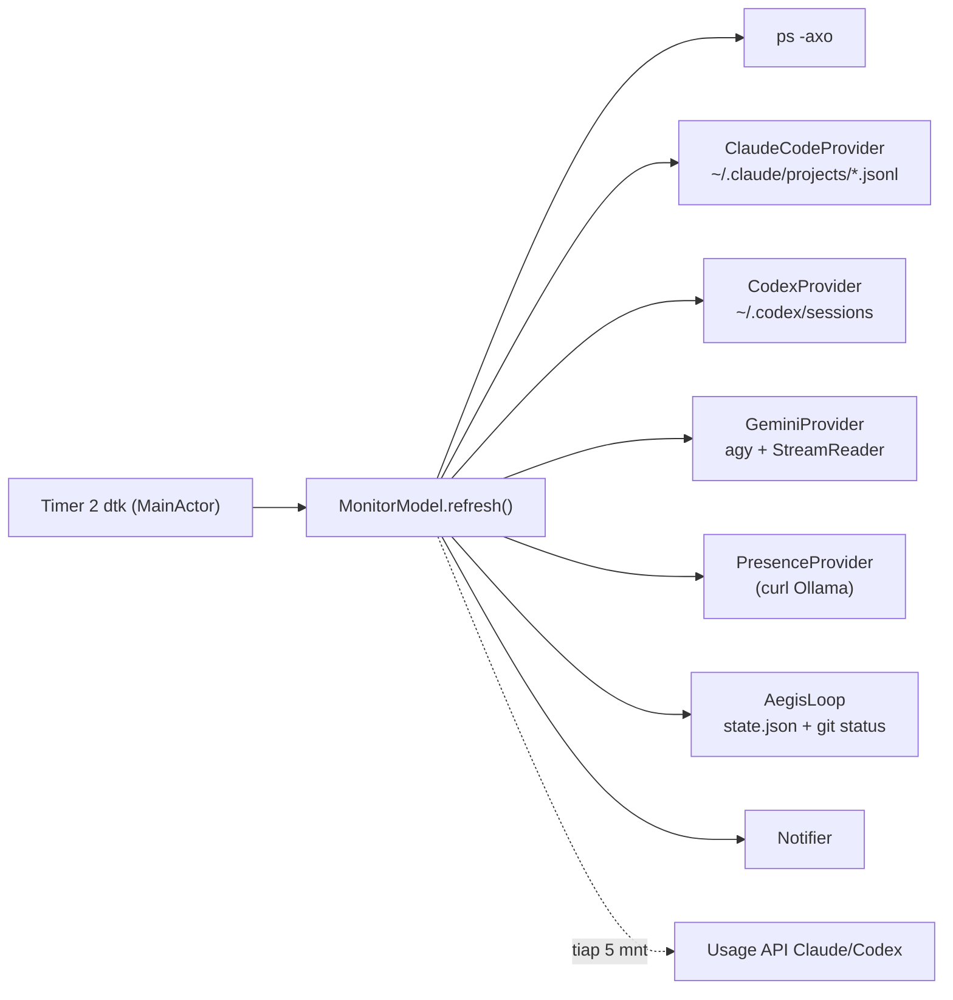

# Agent Monitor — Review Kode & Saran Pengembangan

## Gambaran singkat

Aplikasi menu bar macOS (SwiftUI, ~2.750 baris, tanpa dependensi) yang memantau agen AI lewat **transcript JSONL** (Claude Code, Codex), **stream-json log** (`agy`/Gemini, loop Aegis), **daftar proses** (`ps`), dan **endpoint usage** (Anthropic/OpenAI).

**Yang sudah bagus:** pembacaan JSONL inkremental dengan tail window ([JSONLTail](Sources/AgentMonitor/Support.swift#L143-L195)), skip blob besar tanpa parse (`hasType`), cache argumen/cwd per PID, mode `--dump` untuk debug dari terminal, data usage lama tetap tampil saat refresh gagal, dan komentar kode yang jelas.

---

## 1. Temuan teknis (perlu dibenahi dulu)

| # | Temuan | Lokasi | Dampak |
|---|---|---|---|
| 1 | **Semua polling jalan di main thread.** Tiap 2 detik: spawn `ps`, `curl` ke Ollama (timeout 1 dtk!), `git status` + `git diff` (tiap 6 dtk), `lsof`, parse JSONL hingga 1 MB/file. | [refresh()](Sources/AgentMonitor/MonitorModel.swift#L127-L146), [ollamaModels()](Sources/AgentMonitor/Providers/PresenceProvider.swift) | UI bisa tersendat, terutama repo besar / Ollama lambat |
| 2 | **"Menunggu izin" hanya ditebak** (tool terbuka > 20 dtk), state tetap `.working` → **tidak ada notifikasi** saat Claude sebenarnya butuh persetujuan Anda. | [ClaudeTranscript.session](Sources/AgentMonitor/Providers/ClaudeCodeProvider.swift#L104-L113) | Kasus terpenting justru terlewat |
| 3 | Logika `append` / `mark` / `closeTool` diduplikasi persis di Claude & Codex transcript. | ClaudeCodeProvider / CodexProvider | Sulit dirawat saat menambah agen baru |
| 4 | Belum ada test target; parser JSONL adalah kandidat ideal untuk test berbasis fixture. | [Package.swift](Package.swift) | Format log agen sering berubah → regresi diam-diam |
| 5 | Proyek **belum di-`git init`** dan tanpa README. | root | Tidak ada riwayat perubahan |
| 6 | Notifikasi tanpa aksi & tanpa `threadIdentifier`; klik notifikasi tidak membawa ke sesi. | [Notifier](Sources/AgentMonitor/Notifier.swift) | Kurang actionable |
| 7 | `model.models` dihitung ulang tiap render (cek `fileExists` + stat). | [MonitorModel.swift:44](Sources/AgentMonitor/MonitorModel.swift#L44) | Minor |

**Rekomendasi arsitektur:**
- Pindahkan provider ke sebuah `actor PollingEngine`; main actor hanya menerima snapshot hasil.
- Ganti polling file dengan **FSEvents / `DispatchSource.makeFileSystemObjectSource`** → lebih hemat baterai dan reaksi instan, bukan 2 dtk.
- Buat `protocol AgentProvider { func poll(_ ctx: PollContext) -> [AgentSession] }` + base class `TranscriptActivityLog` untuk logika aktivitas bersama.
- Ollama: pakai `URLSession` async, bukan spawn `curl`.

---

## 2. Saran fitur — berguna & menarik

### ⭐ Prioritas tinggi (dampak besar, usaha wajar)

#### A. Status akurat via Claude Code Hooks
Claude Code mendukung hooks (`Notification`, `Stop`, `PreToolUse`, `PostToolUse`, `UserPromptSubmit`, `SessionStart/End`). Agent Monitor bisa memasang hook kecil di `~/.claude/settings.json` yang menulis event ke `~/.agent-monitor/events.jsonl` (atau Unix socket).
- Hook `Notification` = **pasti** sedang minta izin → state baru `.needsPermission` + notifikasi instan.
- Menyelesaikan temuan #2 tanpa heuristik.
- Tombol "Pasang hook" di tab pengaturan (dengan backup settings).

#### B. "Lompat ke sesi" dari panel & notifikasi
- Cari TTY proses agen (`ps -o tty`) → fokuskan tab Terminal/iTerm lewat AppleScript, atau `code <project>` untuk VS Code.
- Aksi notifikasi: **Buka**, **Tunda 10 mnt**, **Tutup pantauan**.

#### D. Prediksi habisnya kuota (burn rate)
Data usage sudah diambil tiap 5 menit — tinggal disimpan historinya.
- *"Dengan laju sekarang, Sesi 5 jam habis ~15.20 (reset 16.00)"*.
- Notifikasi ambang 75% / 90%, sparkline kecil di `UsageLimitRow`.

#### E. Monitor percakapan Antigravity
Anda memakai Antigravity — transcript-nya ada di `~/.gemini/antigravity/brain/<id>/.system_generated/logs/transcript.jsonl` dengan `step_index`, `type`, `tool_calls`. Formatnya mirip yang sudah di-parse `StreamReader`, jadi provider baru ini relatif murah.

### 📊 Insight & analitik

#### F. Riwayat & dashboard harian (Swift Charts, sudah tersedia di macOS 13)
Simpan ringkasan sesi ke SQLite / JSON harian:
- Biaya & token per hari / per proyek / per model.
- **"Waktu agen menunggu Anda"** vs **"waktu agen bekerja"** — metrik produktivitas yang jarang dimiliki tool lain.
- Tool paling lambat (mis. `Bash: npm test` rata-rata 2 mnt).

#### G. Timeline / Gantt aktivitas sesi
Data `startedAt` + `duration` per activity sudah ada → tampilkan bar horizontal per tool call. Mudah melihat di mana waktu habis dan tool paralel.

#### H. Heatmap file
*"File apa yang paling sering diedit agen minggu ini?"* dan pencarian lintas transcript: *"sesi mana yang menyentuh `auth.swift`?"*

### 🛡️ Keamanan & kontrol

#### I. Deteksi agen macet / berputar-putar
- Tool aktif > N menit (dev server yang tak pernah selesai).
- Tool yang sama gagal berulang kali (loop error).
- Biaya sesi melonjak tiba-tiba → peringatan.

#### J. Watchlist perintah berbahaya
Tandai merah (+ notifikasi) bila aktivitas berisi `rm -rf`, `git push --force`, `DROP TABLE`, akses `.env`/kredensial. Bisa digabung dengan hook `PreToolUse` (fitur A) untuk benar-benar **memblokir**.

#### K. Kontrol Loop Aegis dari panel
- Tombol **Jeda / Lanjut / Buka blokir** (menulis `state.json`).
- Daftar temuan REVIEW.md (bukan cuma hitungan) + diff viewer file yang berubah langsung di panel.
- Timeline putaran: berapa lama tiap putaran, berapa temuan per putaran.

### ✨ Quality-of-life

- **Global hotkey** (mis. ⌥⌘A) untuk toggle panel.
- **Ikon menu bar animasi** saat ada agen bekerja; warna oranye saat menunggu.
- **Quiet hours** / ikut mode Focus macOS; suara berbeda per jenis event.
- **Agen tambahan**: Cursor, Aider, OpenCode, Copilot CLI.

---

## 3. Usulan urutan pengerjaan

| Tahap | Isi | Alasan |
|---|---|---|
| 0 | `git init`, README, test target + fixture JSONL | Fondasi aman sebelum refactor |
| 1 | Polling ke background actor + FSEvents, protocol provider | Menghilangkan risiko UI freeze, memudahkan fitur berikutnya |
| 2 | **A (hooks)** + **B (lompat ke sesi)** + aksi notifikasi | Nilai harian paling terasa |
| 3 | **D (burn rate)** + **F (riwayat)** | Butuh penyimpanan histori yang sama |
| 4 | **C (notif HP)**, **E (Antigravity)**, **K (kontrol Aegis)** | Fitur pembeda |
| 5 | Sisanya sesuai selera | |
